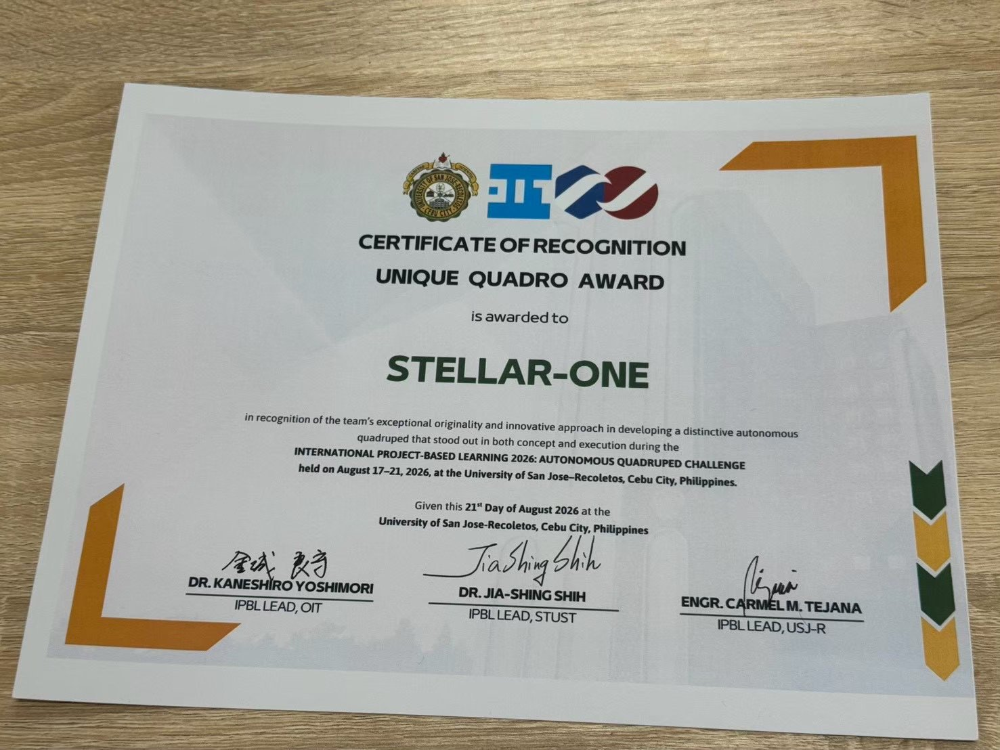
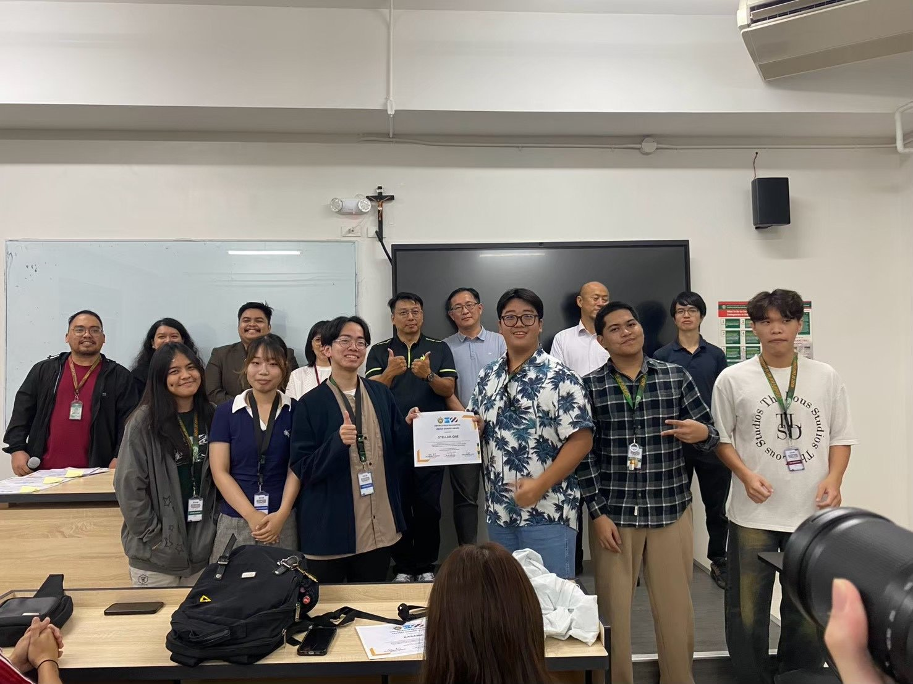
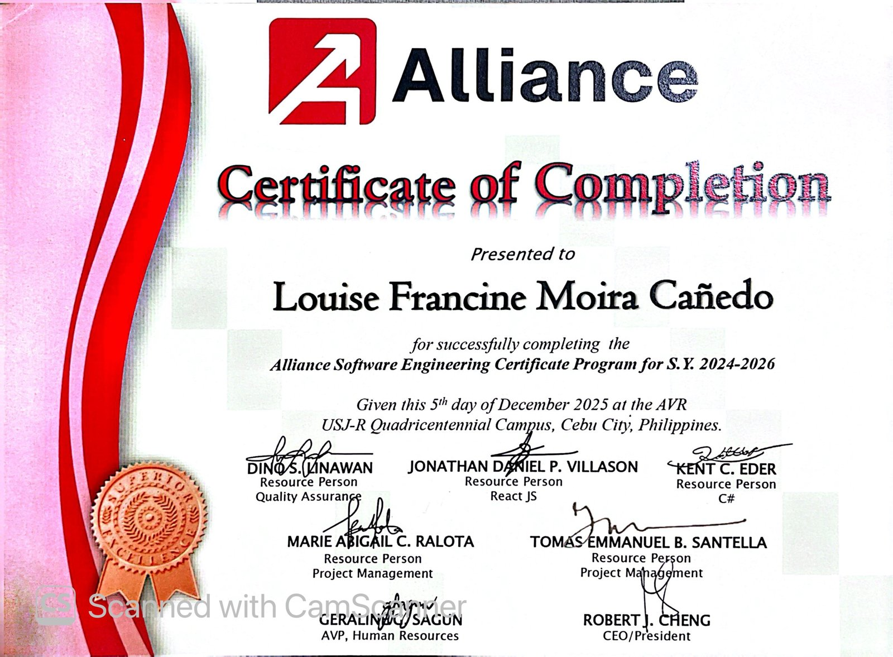
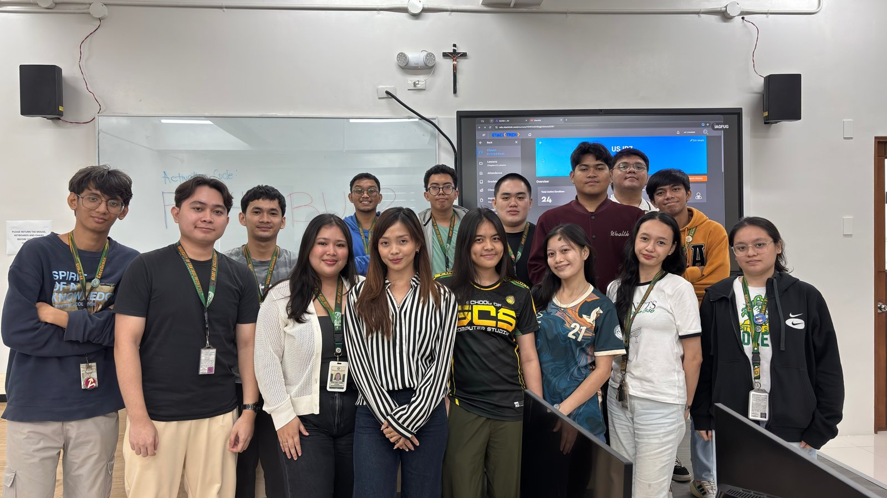
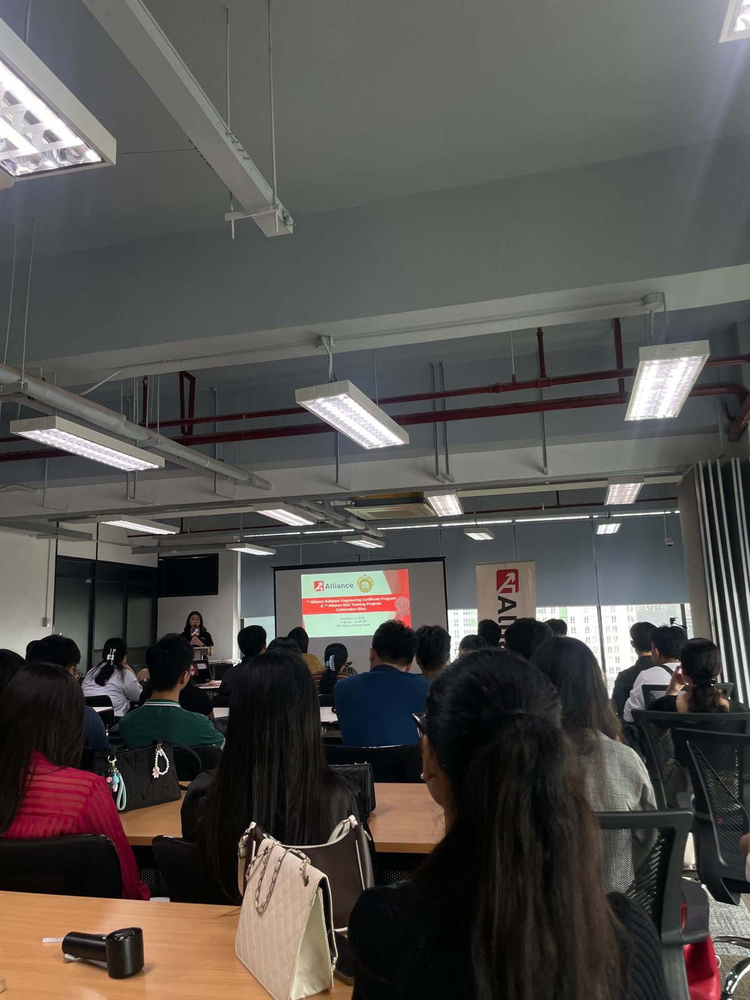
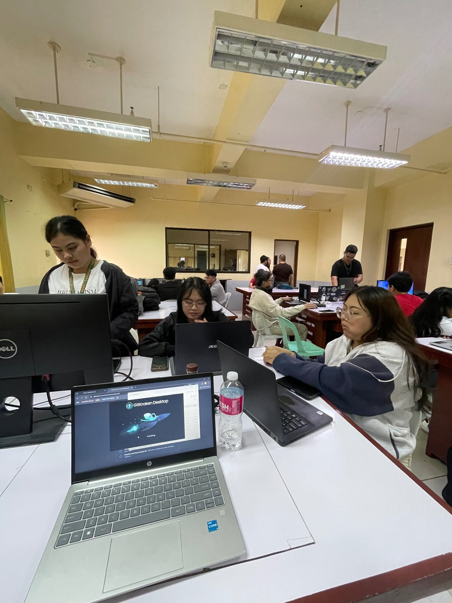

<h1 align="center">Louise Francine Moira Cañedo</h1>

  4th-year Computer Science student · Full-stack, IoT & applied AI 
  <b>Open for practicum / OJT</b> · Cebu City, Philippines

  
  <!-- TODO: add LinkedIn badge once URL is provided
  
  -->
  

  

---

## 👋 About me

I'm a B.S. Computer Science student at the **University of San Jose–Recoletos** (expected graduation **July 2027**). I like taking a project from problem to deployment: web systems, IoT that controls real rooms, and AI that solves real scheduling and vision problems. I'm looking for a **practicum / OJT** where I can contribute to a real codebase and learn from a team.

**What I can bring to a team**
- Full-stack web development (React, Laravel, PHP, JavaScript/TypeScript, SQL) and REST APIs
- IoT and device control over MQTT in a live campus deployment
- Git/GitHub workflow, plus a software engineering certificate program with training in QA, React JS, C#, and project management
- A copyrighted project (SISIG) and an award-winning international team project (IPBL 2026)

---

## 🚀 Featured projects

### Built and deployed

| Project | What it does | Stack | Links |
|---|---|---|---|
| **Alliance Meeting Room Booking System** | Full-stack booking system that manages room schedules, streamlines reservations, and prevents booking conflicts. | React · C# / .NET · SQL | Private (company/school work) |
| **USJR E-Logbook** | Digital logbook for tracking and managing records at USJ-R, streamlining administrative workflows. | — <!-- TODO: stack --> | Private (company/school work) |
| **Classroom Automation / Room Management System** | IoT system that remotely controls classroom lighting and environmental conditions over **MQTT**, used at USJ-R. | MQTT <!-- TODO: hardware --> | Private |
| **Project SISIG** (Sustainable Intelligent System for Innovative Gardening) | Intelligent system that automates plant monitoring and garden management. **Officially copyrighted** (CCR No. 2025-06396-N). | — <!-- TODO: stack --> | Private |

### AI, optimization & computer vision

| Project | What it does | Stack | Links |
|---|---|---|---|
| **TIMBLE** (undergraduate thesis) | Single workspace to plan subject offerings, open sections, and prepare class schedules; estimates subject demand from historical enrollment and curriculum data and suggests section numbers. **Philippine Startup Challenge Central Visayas Top 25 Qualifier** (Team CascadeZero). Uses a hybrid **CSP + PPO reinforcement learning** approach to university timetabling and faculty loading. OR-Tools CP-SAT enforces hard constraints (room capacity, faculty availability, prerequisites); PPO balances timetables and faculty workloads. | Python · OR-Tools CP-SAT · PPO | Private |
| **AutoQuad** (IPBL 2026) | Computer vision system built with an international project-based learning team for the Autonomous Quadruped Challenge. Team **Stellar-One** received the **Unique Quadro Award**. | — <!-- TODO: stack --> | — <!-- TODO: public URL --> |
| **Vehicle Plate Number Recognition** | Computer vision pipeline that detects and reads vehicle license plates from images. | — <!-- TODO: stack --> | — <!-- TODO: public URL --> |
| **Trash Intensification Index (TII)** | NLP techniques to analyze and evaluate trends in waste-related data. | — <!-- TODO: stack --> | — <!-- TODO: public URL --> |
| **Faculty Performance Prediction** | Predictive models that analyze and forecast faculty performance metrics. | — <!-- TODO: stack --> | Private |

> Some work was done for institutions or companies, so source code and screenshots are private. Happy to walk through any of it in an interview.

---

## 🧰 Tech skills

| | |
|---|---|
| **Languages** | Python · PHP · C# · Java · JavaScript/TypeScript · SQL · C/C++ |
| **Web** | Full-stack development · React · Laravel · REST APIs |
| **AI/ML & optimization** | Reinforcement Learning (PPO) · Constraint Programming (OR-Tools CP-SAT) · Computer Vision · NLP · PyTorch · TensorFlow |
| **Systems & IoT** | MQTT · Arduino · Raspberry Pi · networked device control |
| **Tools** | Git/GitHub · Google Colab |

---

## 🏆 Achievements & certifications

| | Date | |
|---|---|---|
| 🥇 **Unique Quadro Award**, Team Stellar-One, IPBL 2026 Autonomous Quadruped Challenge | Aug 2026 | [View certificate](assets/certificates/ipbl-2026-unique-quadro-award.jpg) |
| 🌏 **IPBL 2026 Participation**, International Project-Based Learning Program (USJ-R with OIT and STUST) | Aug 2026 | [View certificate](assets/certificates/ipbl-2026-participation.jpg) |
| 🎓 **Alliance Software Engineering Certificate Program** (S.Y. 2024–2026) | Dec 2025 | [View certificate](assets/certificates/alliance-software-engineering-2025.jpg) |
| 📝 **TOPCIT**, Level 2 | 2026 | |
| ©️ **Copyright registration**, Project SISIG (CCR No. 2025-06396-N) | 2025 | |

**In progress**
- 🔄 Philippine Startup Challenge (PSC) Regional Competition: TIMBLE (Team CascadeZero) is a **Central Visayas Top 25 Qualifier** (ongoing)
- 🔄 TESDA AI Upskilling Training Program (certificate pending)

---

## 📸 Documentation

  
  

  
  

  
  

---

## 📫 Let's connect

I'm available for **practicum / OJT**. Email me at **louisefrancinemoira.canedo.23@usjr.edu.ph**.

Last updated: October 2026
